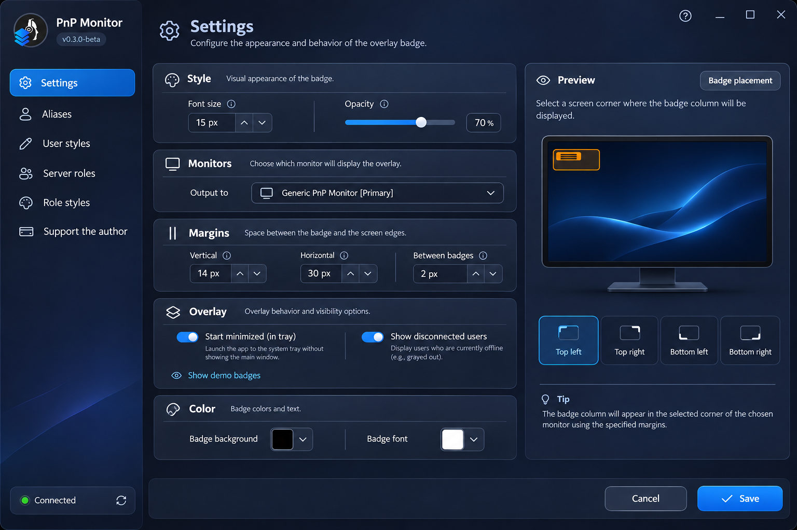

# TS6 Overlay

[](https://github.com/EkzoMan/TS6-Overlay/actions/workflows/ci.yml)
[](https://github.com/EkzoMan/TS6-Overlay/releases)
[](LICENSE)

[Русский](README.md) · [English](README.en.md) · **Deutsch** · [中文](README.zh.md)

**TS6 Overlay** ist ein kostenloses Open-Source-Overlay für **TeamSpeak 6**, das anzeigt, wer gerade spricht — direkt über Ihren Spielen und Anwendungen. Klassische Namens-Badges, Rollenfarben des Servers, Avatare und Beitritts-/Verlassen-Benachrichtigungen — alles konfigurierbar und kaum ablenkend vom Spiel.

<p align="center">
  
</p>

## Funktionen

- 🎙️ **Sprechende-Badges** — Nicknames aktiver Sprecher werden in Echtzeit über dem Spiel angezeigt
- 🎨 **Badge-Stile** — Hintergrund- und Textfarbe, Größe, Transparenz und innere Abstände
- 👥 **Rollen-Stile des Servers** — Badges werden in den Farben der Servergruppen (Rollen) eingefärbt
- 🙋 **Eigene Nutzer-Stile** — persönlicher Badge-Farb pro Nickname
- 🔤 **Aliasse** — Umbenennen von Nutzern im Overlay
- 🖼️ **Avatare** — Nutzerbild neben dem Badge (links oder rechts)
- 📢 **Benachrichtigungen** — Betreten/Verlassen von Server und eigenem Kanal (optional)
- 🖥️ **Jeder Monitor** — Wahl des Ausgabebildschirms und der Positionsecke (9 Positionen)
- 🌐 **4 Sprachen** — Englisch, Russisch, Deutsch, Chinesisch
- 🔄 **Automatische Updates** — Prüfung auf neue GitHub-Releases direkt aus der App

## Screenshots

| Einstellungsfenster                                      | Overlay                                              |
| -------------------------------------------------------- | ---------------------------------------------------- |
| .png) | .png) |

## Installation

### Windows (MSI)

1. Laden Sie `TS6Overlay-<Version>-win-x64.msi` von der [Releases-Seite](https://github.com/EkzoMan/TS6-Overlay/releases/latest) herunter
2. Starten Sie das Installationsprogramm und folgen Sie den Anweisungen

### macOS (DMG)

1. Öffnen Sie das Festplattenabbild und ziehen Sie **TS6 Overlay** in den Ordner **Programme**
2. Beim ersten Start, falls macOS vor einer nicht signierten App warnt — Rechtsklick auf die App → „Öffnen“ → „Öffnen“

> Alternative — der `.pkg`-Installer desselben Releases (Installationsassistent nach `/Applications`).

Da die App kein Apple-Zertifikat hat, markiert macOS sie als unsicher. Um sie zu starten, öffnen Sie das Terminal und führen Sie folgenden Befehl aus:

```shell
xattr -d com.apple.quarantine '/Applications/TS6 Overlay.app'
```

### Linux (DEB)

1. Laden Sie `TS6Overlay-<Version>-linux-amd64.deb` herunter
2. `sudo apt install ./TS6Overlay-<Version>-linux-amd64.deb`

> Alle Pakete sind **self-contained**: die .NET-Laufzeitumgebung ist bereits enthalten, es muss nichts zusätzlich installiert werden.

> ⚠️ **TeamSpeak 6** muss mit aktiviertem **Remote Apps SDK** laufen — darüber erhält das Overlay die Daten über aktive Sprecher.

## Schnellstart

1. Starten Sie TS6 Overlay — ein Symbol erscheint im Systemtray
2. Öffnen Sie die **Einstellungen** (Klick auf das Tray-Symbol) → Reiter **„Über“** — dort ist auch die Update-Prüfung verfügbar
3. Fügen Sie den **API-Schlüssel** aus TeamSpeak 6 (Remote Apps) ein, falls er nicht automatisch übernommen wurde
4. Wählen Sie **Monitor** und **Positionsecke** für die Badges
5. Sprechen Sie — die Badges erscheinen von ganz allein!

## Aus den Quellen bauen

Erfordert .NET SDK 10.0.

```bash
# App bauen
dotnet build src/TS6Overlay.App/TS6Overlay.App.csproj -c Release

# Tests ausführen
dotnet test tests/TS6.Core.Tests/TS6.Core.Tests.csproj -c Release

# Self-contained-Binary veröffentlichen
dotnet publish src/TS6Overlay.App/TS6Overlay.App.csproj -c Release -r win-x64 --self-contained
```

## Architektur

```
├── src/TS6Overlay.App     # Avalonia-UI (plattformübergreifende Oberfläche, v1.x)
├── TS6Services            # Kern: WebSocket-Client, Dispatchers, Einstellungen
├── tests/TS6.Core.Tests   # Unit-Tests des Kerns
└── packaging/             # MSI (WiX)-, PKG-, DEB-Skripte
```

- **TS6Services** — UI-unabhängiger Kern: Verbindung zu TeamSpeak 6 über das Remote Apps SDK (WebSocket), Client-/Badge-/Update-Dispatchers, Einstellungsspeicher mit Migration und atomarem Schreiben.
- **src/TS6Overlay.App** — Oberfläche auf **Avalonia 11** (Windows/macOS/Linux). Live-Vorschau der Einstellungen, Lokalisierung, dunkles Theme.

## Bekannte Einschränkungen

- **Wayland** (Linux) wird derzeit nicht unterstützt: Das Overlay lässt sich nicht über Fenster legen und erhält kein Click-through. Verwenden Sie X11 — dort funktioniert alles. Unterstützung ist mit dem Update auf Avalonia 12 geplant.

## Den Autor unterstützen

Wenn Ihnen das Projekt gefällt, können Sie die Entwicklung unterstützen:

- **PayPal**: [paypal.com/paypalme/ekzoman](https://www.paypal.com/paypalme/ekzoman)
- **Tinkoff**: [tinkoff.ru/rm/r_ndHgIlccZY.yixVzlUPGl](https://www.tinkoff.ru/rm/r_ndHgIlccZY.yixVzlUPGl/ThA2A54356)

## Lizenz

Dieses Projekt wird unter der **MIT**-Lizenz verbreitet — siehe [LICENSE](LICENSE).
