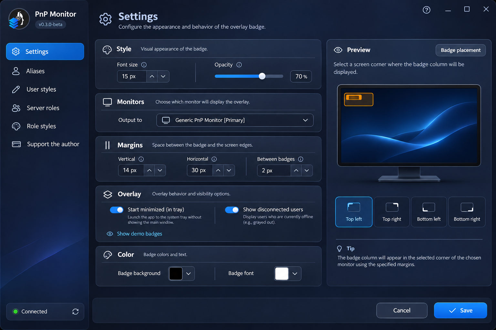

# TS6 Overlay

[](https://github.com/EkzoMan/TS6-Overlay/actions/workflows/ci.yml)
[](https://github.com/EkzoMan/TS6-Overlay/releases)
[](LICENSE)

[Русский](README.md) · **English** · [Deutsch](README.de.md) · [中文](README.zh.md)

**TS6 Overlay** is a free, open-source overlay for **TeamSpeak 6** that shows who is talking right on top of your games and applications. Classic name badges, server role colors, avatars and join/leave notifications — everything is configurable and barely distracts you from the game.

<p align="center">
  
</p>

## Features

- 🎙️ **Talking badges** — nicknames of speaking users are displayed over your games in real time
- 🎨 **Badge styles** — background and text colors, size, opacity and inner paddings
- 👥 **Server role styles** — badges are tinted with server group (role) colors
- 🙋 **Custom user styles** — per-nickname badge colors
- 🔤 **Aliases** — rename users inside the overlay
- 🖼️ **Avatars** — user picture next to the badge (left or right)
- 📢 **Notifications** — server and channel join/leave (optional)
- 🖥️ **Any monitor** — choose the output screen and badge placement corner (9 positions)
- 🌐 **4 UI languages** — English, Russian, German, Chinese
- 🔄 **Auto-updates** — check for new GitHub releases right from the app

## Screenshots

| Settings window                                          | Overlay                                              |
| -------------------------------------------------------- | ---------------------------------------------------- |
| .png) | .png) |

## Installation

### Windows (MSI)

1. Download `TS6Overlay-<version>-win-x64.msi` from the [releases](https://github.com/EkzoMan/TS6-Overlay/releases/latest) page
2. Run the installer and follow the instructions

### macOS (DMG)

1. Open the disk image and drag **TS6 Overlay** into the **Applications** folder
2. On first launch, if macOS warns about an unsigned app — right-click the app → "Open" → "Open"

> Alternative — the `.pkg` installer from the same release (installation wizard into `/Applications`).

Since the app has no Apple certificate, macOS marks it as unsafe. To launch it, open Terminal and run:

```shell
xattr -d com.apple.quarantine '/Applications/TS6 Overlay.app'
```

### Linux (DEB)

1. Download `TS6Overlay-<version>-linux-amd64.deb`
2. `sudo apt install ./TS6Overlay-<version>-linux-amd64.deb`

> All packages are **self-contained**: the .NET runtime is bundled, nothing else needs to be installed.

> ⚠️ **TeamSpeak 6** must be running with the **Remote Apps SDK** enabled — this is how the overlay receives talking data.

## Quick start

1. Launch TS6 Overlay — an icon will appear in the system tray
2. Open **settings** (click the tray icon) → the **About** tab — update checks are available there as well
3. Paste the **API key** from TeamSpeak 6 (Remote Apps) if it was not picked up automatically
4. Choose the **monitor** and the **corner** for badge placement
5. Talk — the badges will appear on their own!

## Building from source

Requires .NET SDK 10.0.

```bash
# Build the app
dotnet build src/TS6Overlay.App/TS6Overlay.App.csproj -c Release

# Run tests
dotnet test tests/TS6.Core.Tests/TS6.Core.Tests.csproj -c Release

# Publish a self-contained binary
dotnet publish src/TS6Overlay.App/TS6Overlay.App.csproj -c Release -r win-x64 --self-contained
```

## Architecture

```
├── src/TS6Overlay.App     # Avalonia UI (cross-platform interface, v1.x)
├── TS6Services            # Core: WebSocket client, dispatchers, settings
├── tests/TS6.Core.Tests   # Core unit tests
└── packaging/             # MSI (WiX), PKG, DEB scripts
```

- **TS6Services** — UI-agnostic core: connection to TeamSpeak 6 via the Remote Apps SDK (WebSocket), client/badge/update dispatchers, settings storage with migration and atomic writes.
- **src/TS6Overlay.App** — **Avalonia 11** UI (Windows/macOS/Linux). Live settings preview, localization, dark theme.

## Known limitations

- **Wayland** (Linux) is not supported yet: the overlay cannot stay on top of windows and does not get click-through. Use X11 — everything works there. Support is planned with the update to Avalonia 12.

## Support the author

If you find the project useful, you can support its development:

- **PayPal**: [paypal.com/paypalme/ekzoman](https://www.paypal.com/paypalme/ekzoman)
- **Tinkoff**: [tinkoff.ru/rm/r_ndHgIlccZY.yixVzlUPGl](https://www.tinkoff.ru/rm/r_ndHgIlccZY.yixVzlUPGl/ThA2A54356)

## License

This project is distributed under the **MIT** license — see [LICENSE](LICENSE).
