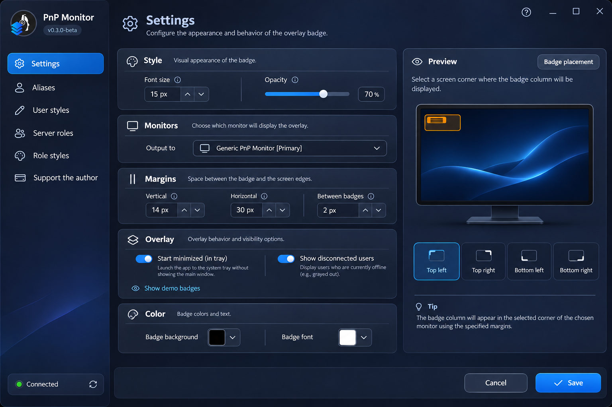

# TS6 Overlay

[](https://github.com/EkzoMan/TS6-Overlay/actions/workflows/ci.yml)
[](https://github.com/EkzoMan/TS6-Overlay/releases)
[](LICENSE)

**Русский** · [English](README.en.md) · [Deutsch](README.de.md) · [中文](README.zh.md)

**TS6 Overlay** — бесплатный оверлей с открытым исходным кодом для **TeamSpeak 6**, который показывает, кто говорит, прямо поверх ваших игр и приложений. Классические бейджи с никнеймами, цвета ролей сервера, аватары и уведомления о входе/выходе — всё настраивается и почти не отвлекает от игры.

<p align="center">
  
</p>

## Возможности

- 🎙️ **Бейджи говорящих** — никнеймы говорящих пользователей отображаются поверх игр в реальном времени
- 🎨 **Стили бейджей** — цвет фона, шрифта, размер, прозрачность и внутренние отступы
- 👥 **Стили ролей сервера** — бейджи окрашиваются в цвета серверных групп (ролей)
- 🙋 **Свои стили для пользователей** — персональные цвета бейджа по никнейму
- 🔤 **Псевдонимы** — переименование пользователей в оверлее (алиасы)
- 🖼️ **Аватары** — изображение пользователя рядом с бейджем (слева или справа)
- 📢 **Уведомления** — вход/выход на сервере и в вашем канале (опционально)
- 🖥️ **Любой монитор** — выбор экрана вывода и угла размещения (9 позиций)
- 🌐 **4 языка интерфейса** — английский, русский, немецкий, китайский
- 🔄 **Автообновления** — проверка новых релизов GitHub прямо из приложения

## Скриншоты

| Окно настроек                                              | Оверлей                                                  |
| ---------------------------------------------------------- | -------------------------------------------------------- |
| .png) | .png) |

## Установка

### Windows (MSI)

1. Скачайте `TS6Overlay-<версия>-win-x64.msi` со страницы [релизов](https://github.com/EkzoMan/TS6-Overlay/releases/latest)
2. Запустите установщик и следуйте инструкциям

### macOS (DMG)

. Откройте образ и перетащите **TS6 Overlay** в папку **Applications**
. При первом запуске, если macOS предупреждает о неподписанном приложении — ПКМ по приложению → «Открыть» → «Открыть»

> Альтернатива — установщик `.pkg` того же релиза (мастер установки в `/Applications`).

Так как приложение не имеет сертификата Apple, оно помечается системой как вредоносное. Для запуска откройте терминал и выполните команду:

```shell
xattr -d com.apple.quarantine '/Applications/TS6 Overlay.app'
```

### Linux (DEB)

1. Скачайте `TS6Overlay-<версия>-linux-amd64.deb`
2. `sudo apt install ./TS6Overlay-<версия>-linux-amd64.deb`

> Все пакеты **self-contained**: среда .NET уже включена, ничего дополнительно устанавливать не нужно.

> ⚠️ **TeamSpeak 6** должен быть запущен с включённым **Remote Apps SDK** — именно через него оверлей получает данные о говорящих.

## Быстрый старт

1. Запустите TS6 Overlay — иконка появится в системном трее
2. Откройте **настройки** (клик по иконке трея) → вкладка **«О программе»** — там же доступна проверка обновлений
3. Вставьте **API-ключ** из TeamSpeak 6 (Remote Apps), если он не подхватился автоматически
4. Выберите **монитор** и **угол** размещения бейджей
5. Говорите — бейджи появятся сами!

## Сборка из исходников

Требуется .NET SDK 10.0.

```bash
# Сборка приложения
dotnet build src/TS6Overlay.App/TS6Overlay.App.csproj -c Release

# Запуск тестов
dotnet test tests/TS6.Core.Tests/TS6.Core.Tests.csproj -c Release

# Публикация самодостаточного бинарника
dotnet publish src/TS6Overlay.App/TS6Overlay.App.csproj -c Release -r win-x64 --self-contained
```

## Архитектура

```
├── src/TS6Overlay.App     # Avalonia UI (кроссплатформенный интерфейс, v1.x)
├── TS6Services            # Ядро: WebSocket-клиент, диспетчеры, настройки
├── tests/TS6.Core.Tests   # Модульные тесты ядра
└── packaging/             # MSI (WiX), PKG, DEB-скрипты
```

- **TS6Services** — ядро, не зависящее от UI: подключение к TeamSpeak 6 через Remote Apps SDK (WebSocket), диспетчеры клиентов/бейджей/обновлений, хранилище настроек с миграцией и атомарной записью.
- **src/TS6Overlay.App** — интерфейс на **Avalonia 11** (Windows/macOS/Linux). Живой предпросмотр настроек, локализация, тёмная тема.

## Известные ограничения

- **Wayland** (Linux) пока не поддерживается: оверлей не поднимается над окнами и не получает click-through. Используйте X11 — на нём всё работает. Поддержка запланирована с обновлением до Avalonia 12.

## Поддержать автора

Если проект вам полезен, можно поддержать разработку:

- **PayPal**: [paypal.com/paypalme/ekzoman](https://www.paypal.com/paypalme/ekzoman)
- **Tinkoff**: [tinkoff.ru/rm/r_ndHgIlccZY.yixVzlUPGl](https://www.tinkoff.ru/rm/r_ndHgIlccZY.yixVzlUPGl/ThA2A54356)

## Лицензия

Проект распространяется по лицензии **MIT** — см. [LICENSE](LICENSE).
