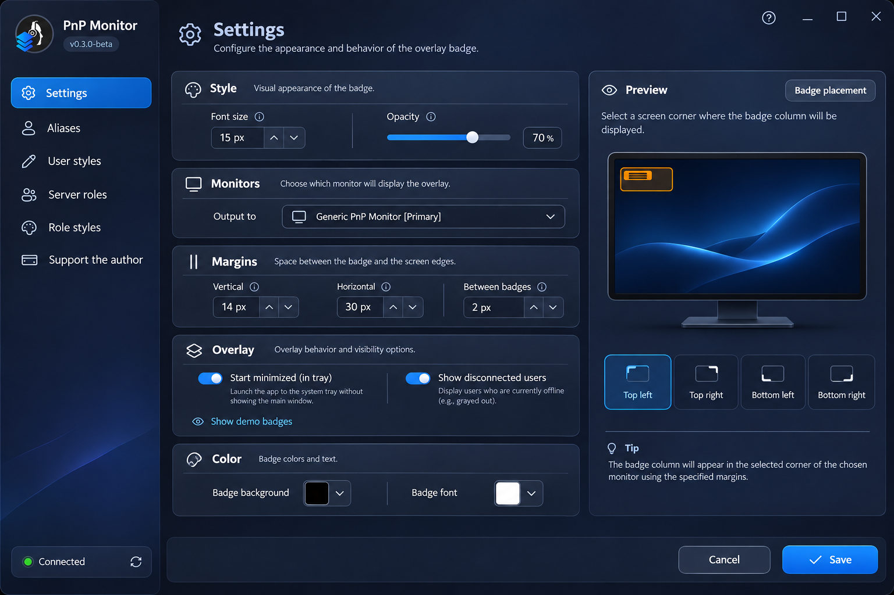

# TS6 Overlay

[](https://github.com/EkzoMan/TS6-Overlay/actions/workflows/ci.yml)
[](https://github.com/EkzoMan/TS6-Overlay/releases)
[](LICENSE)

[Русский](README.md) · [English](README.en.md) · [Deutsch](README.de.md) · **中文**

**TS6 Overlay** 是一款免费、开源的 **TeamSpeak 6** 悬浮覆盖层，可在您的游戏和应用上方直接显示谁在讲话。经典的昵称徽章、服务器身份组颜色、头像以及进出通知——全部可自定义，几乎不会打扰游戏。

<p align="center">
  
</p>

## 功能特性

- 🎙️ **讲话徽章** — 实时在游戏上方显示正在讲话用户的昵称
- 🎨 **徽章样式** — 背景色、字体颜色、大小、透明度和内边距
- 👥 **服务器身份组样式** — 徽章按服务器身份组（角色）着色
- 🙋 **用户自定义样式** — 按昵称设置个人徽章颜色
- 🔤 **别名** — 在覆盖层中为用户重新命名
- 🖼️ **头像** — 在徽章旁显示用户头像（左侧或右侧）
- 📢 **通知** — 服务器及本频道成员进出提醒（可选）
- 🖥️ **任意显示器** — 选择输出屏幕和摆放位置（9 个方位）
- 🌐 **4 种界面语言** — 英语、俄语、德语、中文
- 🔄 **自动更新** — 直接在应用内检查 GitHub 新版本

## 截图

| 设置窗口                                     | 覆盖层                                        |
| -------------------------------------------- | --------------------------------------------- |
| .png) | .png) |

## 安装

### Windows（MSI）

1. 从 [Releases](https://github.com/EkzoMan/TS6-Overlay/releases/latest) 页面下载 `TS6Overlay-<版本>-win-x64.msi`
2. 运行安装程序并按提示完成安装

### macOS（DMG）

1. 打开磁盘映像，将 **TS6 Overlay** 拖入 **应用程序** 文件夹
2. 首次启动时，若 macOS 提示应用未经签名——右键点击应用 →「打开」→「打开」

> 替代方案——同一版本提供的 `.pkg` 安装程序（安装向导会将应用放入 `/Applications`）。

由于应用没有 Apple 证书，系统会将其标记为不安全文件。要启动它，请打开终端并执行：

```shell
xattr -d com.apple.quarantine '/Applications/TS6 Overlay.app'
```

### Linux（DEB）

1. 下载 `TS6Overlay-<版本>-linux-amd64.deb`
2. `sudo apt install ./TS6Overlay-<版本>-linux-amd64.deb`

> 所有安装包均为**自包含（self-contained）**：已内置 .NET 运行时，无需额外安装任何依赖。

> ⚠️ **TeamSpeak 6** 必须处于运行状态并启用 **Remote Apps SDK**——覆盖层通过它获取讲话数据。

## 快速上手

1. 启动 TS6 Overlay——系统托盘会出现图标
2. 打开**设置**（点击托盘图标）→「**关于**」选项卡——更新检查也在此处
3. 粘贴来自 TeamSpeak 6（Remote Apps）的 **API 密钥**（若未被自动获取）
4. 选择**显示器**和徽章摆放**位置**
5. 开始讲话——徽章会自动出现！

## 从源码构建

需要 .NET SDK 10.0。

```bash
# 构建应用
dotnet build src/TS6Overlay.App/TS6Overlay.App.csproj -c Release

# 运行测试
dotnet test tests/TS6.Core.Tests/TS6.Core.Tests.csproj -c Release

# 发布自包含二进制文件
dotnet publish src/TS6Overlay.App/TS6Overlay.App.csproj -c Release -r win-x64 --self-contained
```

## 项目结构

```
├── src/TS6Overlay.App     # Avalonia UI（跨平台界面，v1.x）
├── TS6Services            # 核心：WebSocket 客户端、调度器、设置
├── tests/TS6.Core.Tests   # 核心单元测试
└── packaging/             # MSI（WiX）、PKG、DEB 打包脚本
```

- **TS6Services** — 与界面无关的核心：通过 Remote Apps SDK（WebSocket）连接 TeamSpeak 6，客户端/徽章/更新调度器，带迁移和原子写入的设置存储。
- **src/TS6Overlay.App** — 基于 **Avalonia 11** 的界面（Windows/macOS/Linux）。设置实时预览、本地化、深色主题。

## 已知限制

- 目前暂不支持 **Wayland**（Linux）：覆盖层无法置于窗口之上，也不支持鼠标穿透。请使用 X11——一切正常。计划随 Avalonia 12 升级提供支持。

## 支持作者

如果本项目对您有帮助，欢迎支持开发：

- **PayPal**：[paypal.com/paypalme/ekzoman](https://www.paypal.com/paypalme/ekzoman)
- **Tinkoff**：[tinkoff.ru/rm/r_ndHgIlccZY.yixVzlUPGl](https://www.tinkoff.ru/rm/r_ndHgIlccZY.yixVzlUPGl/ThA2A54356)

## 许可证

本项目基于 **MIT** 许可证分发——详见 [LICENSE](LICENSE)。
